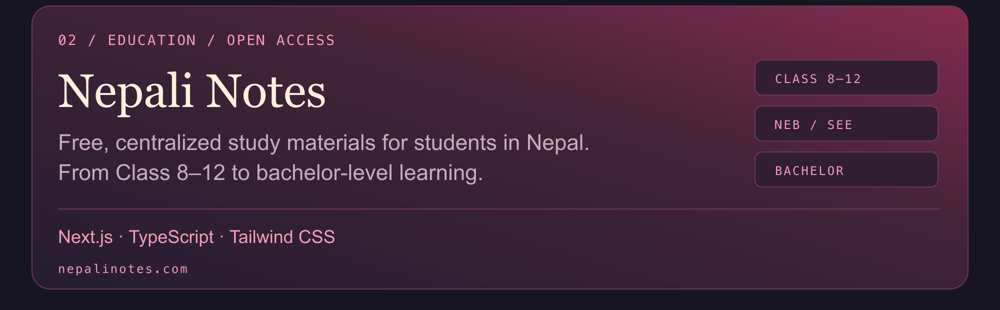
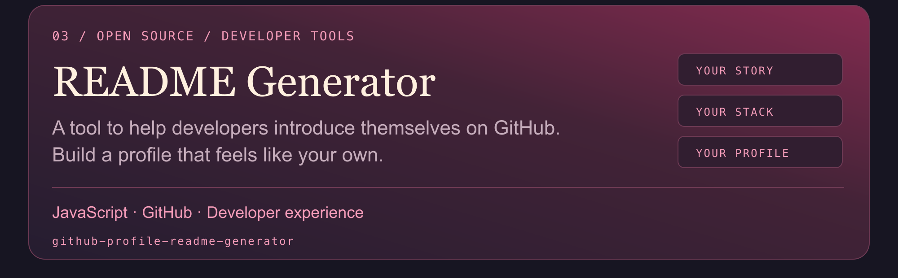
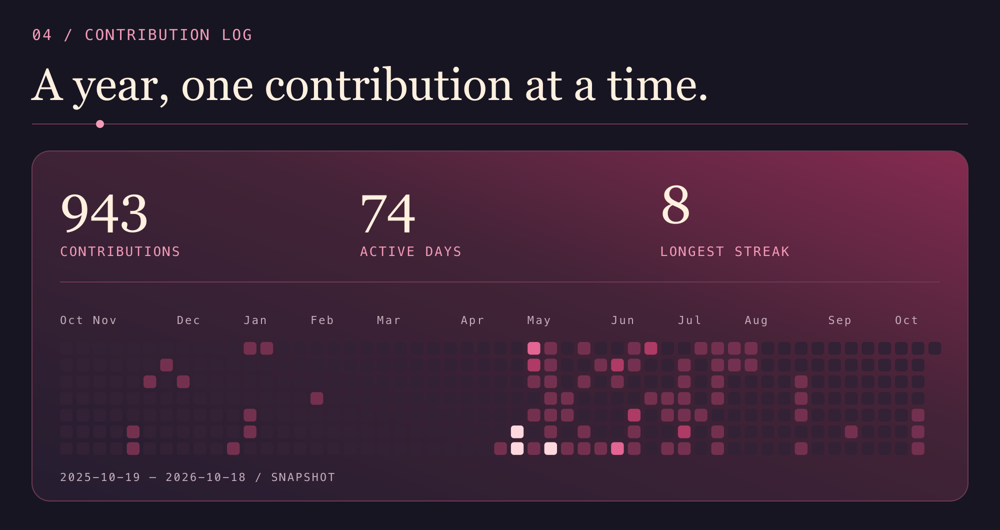

<!-- Custom profile artwork is local to this repository. No third-party image widgets. -->

  

  <a href="https://kiitconnect.com"><b>KIIT CONNECT ↗</b></a> &nbsp; · &nbsp;
  <a href="https://linkedin.com/in/technicalranjit"><b>LINKEDIN ↗</b></a> &nbsp; · &nbsp;
  <a href="mailto:technicalranjit@gmail.com"><b>EMAIL ↗</b></a> &nbsp; · &nbsp;
  <a href="https://github.com/Technicalranjitofficial?tab=repositories"><b>REPOSITORIES ↗</b></a>

Contribution snapshot: October 18, 2026. <a href="https://github.com/Technicalranjitofficial?tab=overview">View current activity ↗</a>

 
 

  <a href="https://linkedin.com/in/technicalranjit">LinkedIn</a> &nbsp; / &nbsp;
  <a href="https://x.com/technicalranjit">X</a> &nbsp; / &nbsp;
  <a href="mailto:technicalranjit@gmail.com">Email</a>

Read the profile as text

### Hi, I'm Ranjit Das.

I'm a full-stack developer and the founder of [KIIT Connect](https://kiitconnect.com). I build student platforms, developer tools, and web experiences — taking ideas from interface to implementation.

### Selected work

- **[KIIT Connect](https://kiitconnect.com)** — academic resources, placement information, and campus utilities. Built with Next.js, TypeScript, MongoDB, and Razorpay.
- **[Nepali Notes](https://nepalinotes.com)** — free study materials for Class 8–12 and bachelor-level students in Nepal. [Source code](https://github.com/Technicalranjitofficial/nepalinotes).
- **[GitHub Profile README Generator](https://github.com/Technicalranjitofficial/github-profile-readme-generator)** — a JavaScript tool to help developers create their GitHub profile.

### Toolkit

| Area | Tools |
| --- | --- |
| Interface | React, Next.js, TypeScript, JavaScript |
| Design | Tailwind CSS, responsive interfaces |
| Server | Node.js, NestJS, Express, REST APIs |
| Data | MongoDB, MySQL, Prisma, Redis |
| Platform | NextAuth, Razorpay |
| Workflow | Git, GitHub |

### Connect

[LinkedIn](https://linkedin.com/in/technicalranjit) · [X](https://x.com/technicalranjit) · [Email](mailto:technicalranjit@gmail.com)

